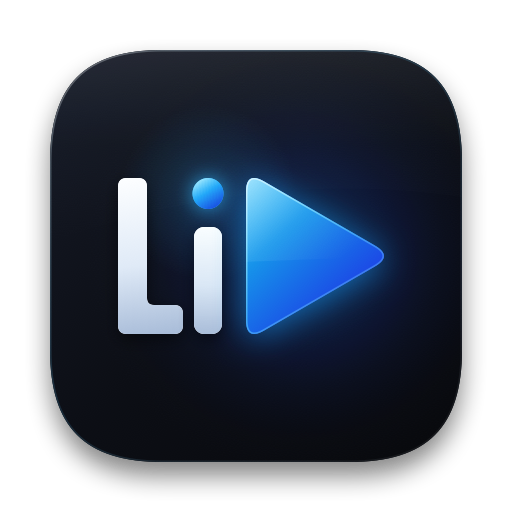

<p align="center">
  
</p>

# LiPlayer

[](LICENSE)
[](CONTRIBUTING.md)

A native Mac media player inspired by PotPlayer's precise playback controls (formerly Video Player). Built with Swift, AppKit, SwiftUI, and libmpv. Original interface and assets; no PotPlayer application code or skins are used.

The current bundle targets **Apple Silicon running macOS 27.2 or later**, matching the native dependency builds and the Mac used for validation.

## Use the app

Download the Apple Silicon app from [GitHub Releases](https://github.com/LiLabsAI/LiPlayer/releases/tag/v0.2.1) (released prior to the rename as `Video Player.app`) or build `LiPlayer.app` from source below, and move it into Applications. Open a file with ⌘O or open a persistent folder Library with ⌘⇧O. Show/hide Library with ⌘⇧L. Quit earlier builds before opening another copy.

**Signing:** this build is ad hoc signed and is not notarized. macOS may block a downloaded copy. A Developer ID signed release is future work; building from source is available below. No automatic updater is included.

- Local video/audio files and direct HTTP/HTTPS/RTSP/RTMP media addresses.
- A persistent folder Library with expandable subfolders, background browsing, natural ordering, missing-drive recovery, and local session restoration.
- A queue with natural folder ordering, reorder/remove, repeat, saved `.lpqueue` files (plus legacy `.vpqueue` compatibility), and local M3U import. HLS manifests remain a single media source.
- Seeking, frame stepping, speed with pitch correction, A–B repeat, chapters, and screenshots.
- Embedded/external subtitles, primary/secondary tracks, timing, scale, and position; ASS styling and multilingual rendering.
- Audio tracks/output devices, A/V delay, volume, and mute.
- Image adjustments, aspect ratio, rotation, zoom/pan, and deinterlacing.
- Native full screen with controls that hide after three idle seconds and return with pointer/keyboard input; floating/compact mode, searchable commands, and customizable shortcuts.
- Local resume/history controls, light/dark/system appearance, and media-key integration.

The inspector exposes codec, decoder, dimensions, frame-rate, and dropped-frame information. Reset Current File Adjustments restores session controls without changing global preferences.

## Build

Requires the Xcode 27.2 toolchain (Swift 6.2 or newer language support), Python 3, and an Apple Silicon Mac. Native dependencies are pinned in [Vendor/manifest.json](Vendor/manifest.json).

```sh
python3 scripts/bootstrap.py
swift test
python3 scripts/package.py --output "dist/LiPlayer.app"
```

`bootstrap.py` verifies and extracts locked dependencies into `Vendor`. It does not install or upgrade Homebrew formulae. A deliberate update uses `--refresh` and requires Homebrew. The packaged app includes its libraries and does not require Homebrew or a separately installed mpv. Open `Package.swift` for Xcode editing.

## Verify

```sh
python3 scripts/make-fixtures.py
python3 scripts/package.py --configuration debug --qa
python3 scripts/verify.py
python3 scripts/verify-workspace.py
```

Fixture generation requires FFmpeg with x264, x265, VP9 and SVT-AV1 encoders. Tests use generated media, loopback HTTP and untrusted HTTPS servers, and isolated QA data. Add `--https-url <direct-media-url>` to test a trusted online stream. Use `--app <bundle-path>` to verify a particular release bundle. The real playback report is saved to [docs/validation/playback.json](docs/validation/playback.json); assertion failures return a failure status.

See the [usage guide](docs/usage.md), [architecture](docs/architecture.md), [validation notes](docs/validation.md), and [completion audit](docs/completion-audit.md).

## Current boundaries

The rendering path uses OpenGL. HDR sources are tone mapped to SDR; native HDR presentation and system Picture in Picture are not included. A compact floating window is provided. Protected streaming services, online subtitle accounts, transcription/translation, recording/capture, and arbitrary extensions remain outside this version.

## Research

- [PotPlayer research and Mac build plan](research/potplayer-macos-research.md)
- [PotPlayer package investigation](research/potplayer-internals.md)

Research downloads, proprietary resources, dependency binaries, and build outputs are excluded from Git by default.

## Contributing & License

Copyright © 2026 [Ali Ahad](https://aliahad.com) · [LI Labs](https://github.com/LiLabsAI).

LiPlayer's original application code and brand assets are free, open-source software licensed under the **GNU General Public License v3.0 (`GPL-3.0-or-later`)** — see [LICENSE](LICENSE).

- **Copyleft protection:** Any distributed fork, modification, or derivative work incorporating LiPlayer's code must also remain open source under GPLv3 with complete corresponding source code provided; this codebase may not be incorporated into distributed closed-source or proprietary software.
- **Ownership & attribution:** Original copyright notices (`Copyright (C) 2026 Ali Ahad`), [NOTICE.md](NOTICE.md), and source-file license headers must be preserved across forks and redistributions.
- **Forks & community contributions:** Developers are welcome to study, modify, fork, report issues, and submit pull requests on [GitHub](https://github.com/LiLabsAI/LiPlayer) — see [CONTRIBUTING.md](CONTRIBUTING.md) and [CODE_OF_CONDUCT.md](CODE_OF_CONDUCT.md).
- **Third-party dependencies:** Bundled libraries retain their own licenses. Notices, checksums, and recipes are bundled in `Contents/Resources/Licenses`; upstream source archives and build resources are attached alongside releases. See [NOTICE.md](NOTICE.md) and [ThirdParty/README.md](ThirdParty/README.md) for source availability and rebuilding. Packaging scripts do not publish automatically.
