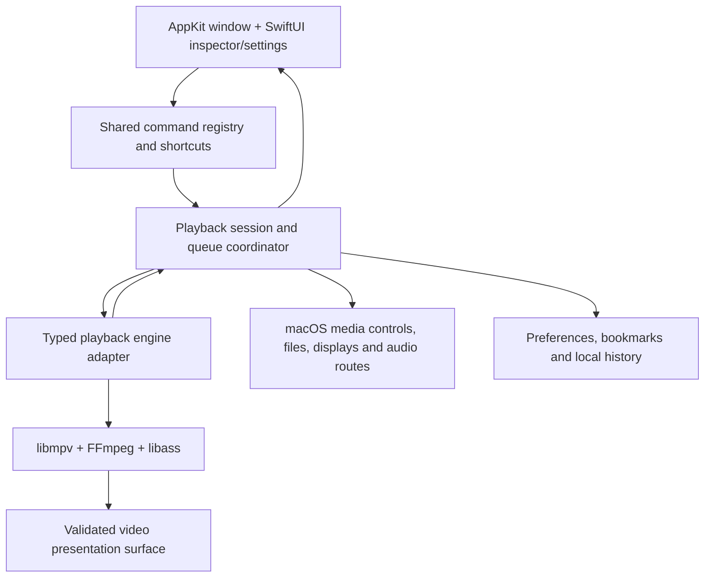

# PotPlayer → a native Mac video player

Research date: **9 November 2026**. Scope: PotPlayer's construction, extension/developer experience, interface and workflows, and a practical architecture and delivery plan for a new macOS player.

## 1. Recommendation

Build an original **native Swift application, with AppKit owning the player window and video surface, SwiftUI for appropriate settings/inspector views, and libmpv providing playback**. Begin with local files, strong subtitle tools, keyboard control, playlists, and reliable resume. Prove the rendering integration before building the complete interface.

The product goal should be **PotPlayer's depth of control with familiar Mac behavior**. A successful first release needs dependable playback and precise interactions; matching every historical PotPlayer feature would create a much larger project.

There is already a close Mac reference: **IINA**. It is a community-maintained, GPLv3 player built on mpv. Its public source provides useful evidence that a Swift application can integrate this engine and offer Mac media controls, gestures, customization, and extensions. It also means that broad codec support alone will not distinguish a new app. Our strongest direction is a particularly good subtitle, inspection, and keyboard-driven workflow. [IINA product](https://iina.io/), [source and build instructions](https://github.com/iina/iina/blob/aafa448615fd1203fd97d32b5c46fc2135b62853/README.md).

This is an architecture recommendation, not a performance result. No Mac engine benchmark or end-to-end playback test was performed during this research.

## 2. What the evidence can establish

The investigation used first-party product material, the current official Windows installer, its extracted resources, and primary source code/documentation for potential Mac engines. See the [PotPlayer investigation appendix](potplayer-internals.md) for package hashes, resource observations, URLs, and confidence levels.

| Evidence | What it supports | What it does not establish |
|---|---|---|
| Official site and dated changelog | Supported Windows distributions, advertised capabilities, documented feature changes | Measured playback quality or every current default |
| Installer inventory, PE imports, RTTI, resources | Native Windows architecture, included components, UI layouts and extension surfaces | Complete internal class graph, code quality, or exact IDE |
| Skin layouts and image atlases | Control hierarchy, visual vocabulary, responsive layout rules | Actual interaction latency, accessibility, or runtime visibility of every control |
| Public Mac engine headers/source | Available APIs, integration constraints, licensing declarations | Performance on this user's media library |

**Boundary:** PotPlayer's Windows application was not run. Browser inspection also encountered service timeouts; no hands-on usability study is claimed. Interface findings below are based on package resources and first-party material. PotPlayer source code, private development process, internal CI, staffing, and test coverage were not available.

## 3. How PotPlayer is built

### Native Windows application and modular media pipeline

The current official package contains a native x64 core DLL, C++ type information, and MFC-related identifiers including `CWinApp`, `CWnd`, and `CMFCDynamicLayout`. Together with `AFX_DIALOG_LAYOUT` resources, these strongly support **native C++/MFC with custom skinned controls**. This is substantially stronger evidence than guessing from screenshots, but it does not reveal the exact Visual Studio release or original source layout. [Package evidence](potplayer-internals.md).

The distribution separates core application code, codec/media helpers, resources, language files, scripts, shaders, and skins. Its own notices identify third-party components such as FFmpeg, MediaInfo, BASS, SQLite, AngelScript, and Whisper-related tooling. Component presence establishes inclusion/declaration; it does not identify every call path or guarantee that every feature is enabled. [Package evidence and notices](potplayer-internals.md).

Windows media integration is reflected in codec/filter/renderer options and current rendering changes. The dated release history reports a switch to D3D11 video and WASAPI audio defaults in release 261021. Microsoft describes DirectShow as a modular graph of COM filters, and now classifies it as legacy technology. That explains the filter-graph vocabulary; it is not a reason to reproduce that Windows implementation on macOS. [Official update history](https://t1.kakaocdn.net/potplayer/PotPlayer/v4/Update2/UpdateEng.html), [Microsoft filter architecture](https://learn.microsoft.com/en-us/windows/win32/directshow/about-directshow-filters).

Conceptually, a capable player needs these cooperating stages:

```text
File / stream
    → container demuxing and track discovery
    → video/audio decoding, using hardware when supported
    → timing, buffering, filters and subtitle composition
    → video presentation + audio output

Controls / shortcuts / playlist / settings
    → commands to that pipeline
    ← state, metadata, progress and errors
```

This is a conceptual model inferred from the observed components and media APIs, not a recovered PotPlayer source diagram.

### Extension and developer experience

PotPlayer's external customization surface is more inspectable than its private development process:

- **Skins:** packaged DSF skin archives contain XML/text layouts and bitmap atlases. They describe control placement, anchoring, variants, and command associations.
- **Scripts:** shipped AngelScript interfaces/examples support service-style extensions such as URL handling and subtitle-related integrations. They are extension contracts, not the source of the player itself.
- **Processing:** shader text and filter/decoder selection expose a technical configuration layer.
- **Configuration:** resources describe customizable keys, mouse/modifier actions, seek behavior, and playback preferences.

The precise extension inventory and local evidence paths are in the [appendix](potplayer-internals.md). A Mac implementation should adopt the separation between playback, commands, and presentation. It should define its own configuration and plugin model rather than assume Windows scripts, DirectShow filters, or skin packages will run unchanged.

### Historical context matters

Kakao's 2007 launch announcement described a combined video player, broadcasting/viewing tool, and community experience. The 2026 changelog records removal of Kakao TV functionality. Some broadcast/chat assets remain in the current package. Therefore, a menu string or sprite does **not** establish that the corresponding feature remains active. [Kakao launch announcement](https://www.kakaocorp.com/page/detail/6050), [official changelog](https://t1.kakaocdn.net/potplayer/PotPlayer/v4/Update2/UpdateEng.html).

## 4. UI and UX: what to learn

### Observed information architecture

The default skin resources describe a central video surface, a compact custom title area, and a bottom control region with transport, seek, and volume controls. Playlist and control-panel surfaces are separate. The control panel groups **Subtitle, Video, Playback, and Audio** tools. Layout variants and width-dependent technical indicators reveal attention to compact windows. These are resource observations, not screenshots of an assembled running window. [Skin evidence](potplayer-internals.md).

The core interaction model is a progression from watching to precise adjustment:

| Layer | Purpose | Mac interpretation proposed here |
|---|---|---|
| Video and transport | Start watching and make common adjustments | Quiet video canvas, clear play/pause and timeline, unobtrusive volume |
| Playlist and tracks | Organize files and select content | Optional queue/chapters sidebar; accessible audio/subtitle selectors |
| Control panel | Adjust the current session | Inspector with Playback, Subtitles, Audio, Video sections |
| Menus and shortcuts | Rapid access to detailed actions | Standard menu bar and a searchable command list sharing the same commands |
| Preferences | Persistent behavior and expert setup | Searchable settings, resettable sections, import/export of safe profiles |

### Strengths to preserve

These are design conclusions from the documented surface:

1. **Precise control is available during playback.** Track selection, subtitle timing, seeking, speed, and image adjustments should be accessible without losing the current scene.
2. **The window can remain compact.** Advanced options do not all need permanent toolbar buttons.
3. **Keyboard users can become very fast.** Stable, discoverable commands and configurable bindings matter as much as visible controls.
4. **Diagnostics are part of the experience.** Codec, active decoder, frame drops, output dimensions, and synchronization state help explain playback problems.
5. **Different media need different preferences.** A file-specific subtitle delay should not silently become a global default.

### Friction to address in our design

These are risks inferred from dense menus and skin-based presentation; they are not measured PotPlayer usability defects:

- Deep configuration can make a simple task hard to discover. Offer plain-language labels, search, sensible defaults, and a one-click reset.
- Multiple routes to the same setting can drift. A single command/state model should drive menus, keyboard bindings, toolbar items, and the inspector.
- Tiny custom controls need particular accessibility work. Use native controls where possible, strong focus indication, VoiceOver descriptions, and adequately sized targets.
- Automatic hiding must not conceal controls while keyboard or assistive-technology focus is inside them.
- Rich image processing can change the intended appearance. Keep original presentation as the default and make enabled adjustments visible and reversible.

### Proposed Mac window and workflows

Use normal macOS window controls and menu conventions. Default to one player window with an optional sidebar. A minimal launch view offers Open File and recent items; recent history can be disabled. During playback, show a timeline with elapsed/remaining time, track selection, speed, and buttons for the queue and inspector. Technical information belongs in a toggled overlay or inspector.

Define these behaviors before implementation:

| Action | Proposed result |
|---|---|
| Open a single video | Play it in the current window; preserve the current queue only according to an explicit preference |
| Open several videos | Create an ordered queue and start the first item |
| Drop a subtitle on a playing video | Attach/select the subtitle; do not replace the queue |
| Open a folder | Scan only the selected scope, use natural sorting, and display the resulting queue |
| Resume a partly watched file | Offer a visible resume/restart choice; remember the preference |
| External drive disappears | Pause or show an actionable unavailable-file state; retain the queue |
| Move an HDR window to another display | Re-evaluate output capability and tone mapping; avoid stale display assumptions |
| Unsupported or damaged media | Identify the failed stage and offer useful diagnostics |

Suggested defaults: ⌘O opens files, ⌘, opens settings, ⌃⌘F toggles full screen, Space pauses, arrows seek, and shortcuts for speed/subtitle timing are documented and customizable. Scope playback keys to the player so typing into search or a text field does not trigger playback actions. These are proposed app behaviors, not PotPlayer key mappings.

## 5. Choosing the Mac playback foundation

| Approach | Evidence-backed strengths | Work or uncertainty | Recommendation |
|---|---|---|---|
| AVFoundation / AVKit | Apple playback, HLS and supported file media; documented HDR/EDR pipeline | Accepted containers/codecs and rich subtitle behavior must be checked; cannot assume PotPlayer-level compatibility | Baseline and possible later specialized backend |
| libmpv | Embedded C API; extensive playback options; builds on FFmpeg and subtitle/rendering libraries | Rendering integration, dependency packaging, license configuration, display handling | **Preferred first candidate** |
| libVLC / VLCKit | VideoLAN's Cocoa wrapper for broad multimedia playback; LGPL distribution route documented | Validate the exact maintained package/API, rendering behavior, and fit for our detailed controls | Credible alternative for the feasibility comparison |
| Direct FFmpeg + custom presentation | Fine-grained control over demuxing/decoding | We would also own synchronization, seeking, buffering, subtitles, output, and many edge cases | Too much engine work for the first product |
| Fork IINA | Existing complete Mac player and build system | GPLv3, inherited architecture, maintenance and product identity | Fastest if we explicitly choose an open-source derivative |

Sources: [Apple HDR/EDR pipeline](https://developer.apple.com/videos/play/wwdc2022/110565/), [mpv project dependencies/build](https://github.com/mpv-player/mpv/blob/d9d402dc07d02c9aa178fb3e33adc390fa2785cc/README.md), [libmpv client API](https://github.com/mpv-player/mpv/blob/d9d402dc07d02c9aa178fb3e33adc390fa2785cc/include/mpv/client.h), [VLCKit](https://github.com/videolan/vlckit), [IINA](https://iina.io/).

AVFoundation exposes the content types it understands; that list is an input to validation, not a promise that every codec inside a listed container plays. Similarly, hardware decoding depends on the machine, codec/profile, bit depth, and engine build. A broad-format player must retain a functional software path. [AVURLAsset content types](https://developer.apple.com/documentation/avfoundation/avurlasset/audiovisualcontenttypes), [mpv hardware-decoding reference](https://mpv.io/manual/stable/#options-hwdec).

### Critical caveat: libmpv is not a drop-in Metal view

The inspected mpv **v0.42.0** public render header lists OpenGL, software, and Direct3D 11 backends. It does **not** expose a Metal render backend. Its software rendering path is explicitly described as slow; that is not a reasonable default for a high-resolution player. The API also has strict render-thread, callback, context, and teardown rules. [Versioned render header](https://github.com/mpv-player/mpv/blob/v0.42.0/include/mpv/render.h).

IINA's inspected `MPVController.swift` uses `MPV_RENDER_API_TYPE_OPENGL`. Its video view separately handles HDR/EDR and display color behavior. This proves a viable class of integration; it does not prove the right long-term rendering choice for a new app. [IINA engine integration](https://github.com/iina/iina/blob/aafa448615fd1203fd97d32b5c46fc2135b62853/iina/MPVController.swift), [video/display handling](https://github.com/iina/iina/blob/aafa448615fd1203fd97d32b5c46fc2135b62853/iina/VideoView.swift).

mpv also has a macOS Vulkan output path which creates a Metal surface. That is a different integration route from its public render API; its presence does not make an arbitrary SwiftUI `MetalView` accept libmpv frames. Apple deprecates OpenGL and recommends Metal. We must evaluate the window/output route and any maintenance burden before selecting it. [mpv macOS Vulkan source](https://github.com/mpv-player/mpv/blob/d9d402dc07d02c9aa178fb3e33adc390fa2785cc/video/out/vulkan/context_mac.m), [Apple migration guidance](https://developer.apple.com/documentation/apple-silicon/porting-your-macos-apps-to-apple-silicon).

**Decision gate:** compare an established OpenGL embedding approach, an appropriate supported native output integration, and VLCKit/AVPlayer baselines on representative files. Record startup/seek latency, frame drops, memory, energy, display correctness, resizing, and full-screen transitions. If the chosen route cannot meet quality or longevity requirements, resolve that before building advanced UI.

### HDR, Dolby Vision, PiP, and streaming promises

- Separate HDR decoding from correct display presentation and SDR tone mapping. Validate actual output on internal/external displays; do not use an HDR metadata badge as proof.
- Apple documents automatic rendering for supported Dolby Vision 8.4 assets on capable AVFoundation devices. That is not evidence for every Dolby Vision profile or an arbitrary mpv rendering path. [Apple Dolby Vision guidance](https://developer.apple.com/av-foundation/Incorporating-HDR-video-with-Dolby-Vision-into-your-apps.pdf).
- Native Picture in Picture needs a compatible presentation pipeline. Apple exposes player-layer and sample-buffer content sources; a libmpv surface is not automatically one of those. Start with a floating compact player and investigate true PiP independently, including subtitle composition and energy cost. [Apple content sources](https://developer.apple.com/documentation/avkit/avpictureinpicturecontroller/contentsource-swift.class), [sample-buffer initializer](https://developer.apple.com/documentation/avkit/avpictureinpicturecontroller/contentsource-swift.class/init(samplebufferdisplaylayer:playbackdelegate:)).
- Distinguish open media URLs from protected streaming services. Netflix/Apple TV-style DRM playback is outside the proposed first release. AirPlay, protected discs, receiver passthrough, 360°/3D, and capture also require separate investigations.

## 6. Proposed architecture and developer experience

This section is an original implementation proposal, not recovered PotPlayer source.



Use small modules with explicit responsibilities:

| Module | Responsibility |
|---|---|
| PlaybackEngine | Load/stop/seek, select tracks, speed, synchronization, typed events and errors |
| VideoSurface | Rendering lifecycle, sizing, screen changes, presentation timing |
| PlaybackSession | Session state, current item, file-specific choices, end-of-file behavior |
| Queue | Item identity, natural ordering, reorder/remove, next/previous and repeat |
| SubtitleService | Local matching, external attachments, language/style/delay; online services later |
| CommandRegistry | Single definitions for labels, enablement, menu actions and key bindings |
| HistoryStore | Opt-in behavior, resume points, bounded local records, clear-history action |
| MacIntegration | File opening, media keys/Now Playing, audio changes and sleep behavior |

Keep engine-specific pointers and option names behind the adapter. Model states such as idle, opening, playing, paused, seeking, buffering, ended, and failed, including unavailable duration/seekability. Tag asynchronous results by session/item generation so a late response from file A cannot update file B.

The client API provides commands, properties and events. Its documentation notes that synchronous calls can block for an unbounded period; callbacks should wake a dedicated event loop. Proposed rule: UI updates on the main actor, engine work on a dedicated serial executor/queue, and rendering isolated according to its API's requirements. Coalesce rapid seek requests and throttle progress updates. Never block the UI waiting for decoding or network operations. [libmpv client contract](https://github.com/mpv-player/mpv/blob/d9d402dc07d02c9aa178fb3e33adc390fa2785cc/include/mpv/client.h).

**Build tooling:** Xcode for the app, Swift Package Manager for suitable Swift modules, and pinned reproducible builds for native dependencies. mpv uses Meson and depends on libraries including FFmpeg, libplacebo, and optional subtitle/text components. IINA's build instructions demonstrate a separate prebuilt-dylib/download workflow and architecture-specific or universal binaries. The lesson is to separate media-dependency compilation from everyday UI builds. [mpv build](https://github.com/mpv-player/mpv/blob/d9d402dc07d02c9aa178fb3e33adc390fa2785cc/README.md), [IINA build](https://github.com/iina/iina/blob/aafa448615fd1203fd97d32b5c46fc2135b62853/README.md).

Proposed developer workflow:

1. Pin source revisions, build flags, compiler/SDK expectations, and checksums in a dependency manifest. Do not require an end user to install Homebrew.
2. Bundle tested libraries in the app with relocatable paths; verify loading on a clean Mac without developer tools.
3. Provide a small deterministic media corpus and a playback diagnostics view. Keep user paths, URL credentials, and filenames out of routine logs.
4. Make UI previews work with a simulated playback state so every UI edit does not require decoding a movie.
5. Test session/queue/command logic separately from the native engine, and test the engine with real media rather than mocks alone.
6. Treat dependency upgrades as playback changes: rerun the corpus and package checks before shipping.

## 7. Feature scope and build sequence

These are proposed milestones and acceptance criteria, not delivery-time estimates.

| Milestone | Deliverable | Completion gate |
|---|---|---|
| **0 — Playback feasibility** | Minimal native host; chosen embedding/output route; diagnostic measurements | Representative SDR/HDR and subtitle samples play; resizing/full-screen/teardown stable; dependency and licensing configuration recorded |
| **1 — Daily player** | Open/drop files, transport, seeking, volume, speed, audio/subtitle tracks, basic chapters and full screen | Local MP4/MKV/WebM corpus passes; corrupted inputs fail clearly; UI stays responsive during open/seek |
| **2 — PotPlayer-style control** | Queue, natural folder order, repeat/A–B loop, frame stepping, subtitle/audio timing, subtitle style, screenshots, resume, keymap editor | Changes have explicit session/global scope; keybindings conflict-check; ASS/font and timing cases verified |
| **3 — Mac polish** | Inspector, display-aware presentation, accessibility, media controls, compact floating mode, energy work | VoiceOver and keyboard flow pass; sleep/wake, Bluetooth/output changes, external SSD and multi-display tests pass |
| **4 — Distribution** | Signed/notarized build, updater strategy, notices/source availability, supported-macOS policy | Clean-machine launch, packaged dependencies, entitlement/signature checks and regression corpus pass |

For the early media corpus, include H.264/AAC MP4, HEVC 10-bit, multi-audio MKV, VP9/AV1 WebM, FLAC, SRT, styled ASS with embedded fonts, bitmap subtitles, unusual aspect ratios, variable frame rate, interlaced footage, missing/corrupt indices, and files with Unicode names. These are validation targets; inclusion here is not a promise that every combination will be supported.

Defer online subtitle accounts, automatic translation/transcription, arbitrary plugins/scripts, web-video extraction, streaming-service integrations, capture/recording, advanced shader packs, and custom skin import until the basic player is dependable. Online subtitle services add provider terms, credentials, rate limits, language ranking, and downloaded-file handling; they are a feature project of their own.

## 8. Quality targets and verification

Choose quantitative thresholds after the first baseline measurements. Avoid invented promises such as universal zero frame drops or a fixed battery advantage.

| Area | Useful measurements / failure cases |
|---|---|
| Playback | Time to first frame, sustained dropped-frame count after warmup, decoder choice, A/V drift, long-play stability |
| Seeking | Request-to-visible-frame latency, exact vs keyframe behavior, rapid repeated seeks, unavailable seeking in live content |
| Rendering | Color bars/reference media, HDR-to-SDR mapping, display changes, Retina scaling, full-screen transition artifacts |
| Subtitles | Font attachment handling, complex scripts, overlapping ASS events, dual subtitles, delay persistence, subtitle-safe placement |
| Performance | CPU/GPU and energy at matched brightness/output conditions; paused/hidden idle usage; memory after repeated file opens |
| Lifecycle | Pause → close, quit while opening, sleep/wake, disconnected drive, audio route changes, end-of-file races |
| Usability | Keyboard-only open/play/seek/track change; VoiceOver labels/slider values; readable focus; controls at small window sizes |
| Packaging | No Homebrew dependency, expected CPU architectures, all dylibs found and signed, clean-machine Gatekeeper launch |

Frame stepping backward, exact seeking in long-GOP files, multi-track transitions, and HDR screenshots deserve explicit tests rather than an assumption that a UI button makes them reliable.

## 9. Licensing, packaging, and file access decisions

PotPlayer's code and shipped skins are proprietary; use the observed capabilities as requirements and create original branding, assets, and implementation. The local extraction is research evidence. See the [package notices/EULA evidence](potplayer-internals.md).

For libmpv, the project declares GPLv2+ by default and an LGPL mode when built without GPL-only components. It explicitly notes that `-Dgpl=false` alone is not a blanket license grant and linked libraries can affect the result. A future closed-source distribution therefore needs an intentionally selected dependency build, not an arbitrary downloaded libmpv binary. [mpv copyright/build conditions](https://github.com/mpv-player/mpv/blob/d9d402dc07d02c9aa178fb3e33adc390fa2785cc/Copyright).

FFmpeg similarly distinguishes LGPL builds from optional GPL/nonfree configurations and publishes distribution guidance. Avoid enabling encoder libraries merely because a general-purpose build includes them when the app only needs playback. Track the shipped build configuration and notices. Open-source license compliance and codec-patent questions are separate distribution considerations. [FFmpeg's own guidance](https://ffmpeg.org/legal.html).

An IINA fork follows its GPLv3 route. A new app using an appropriately built engine is a separate product decision. We do not need to choose the commercial model to write a personal feasibility prototype, but should settle it before investing in release packaging.

For initial external distribution, propose a **Developer ID-signed and notarized download**. Apple requires code signing, Hardened Runtime, and related protections for this flow; notarization does not equal App Review. A Mac App Store edition is a separate release decision and requires App Sandbox. Direct distribution can also use sandboxing. [Apple notarization](https://developer.apple.com/documentation/security/notarizing-macos-software-before-distribution), [App Sandbox](https://developer.apple.com/documentation/security/app-sandbox).

Design file access deliberately: a user-selected video does not imply perpetual access to every sibling file. Sandboxed persistent access uses security-scoped bookmarks; folder/subtitle matching needs the corresponding permitted scope. Balance each access start/stop, handle stale bookmarks and unavailable drives, and keep stored history bounded and user-clearable. [Apple bookmark guidance](https://developer.apple.com/documentation/professional-video-applications/enabling-security-scoped-bookmark-and-url-access).

## 10. What remains to decide before the full build

The research supports starting with a native, local-first, broad-format player. The first technical task is the feasibility host in milestone 0. Decisions to settle through that work are:

1. **Rendering:** which supported embedding/output path provides acceptable display correctness, energy use, and maintenance prospects?
2. **Compatibility target:** Apple Silicon only initially, or Intel as well; minimum macOS release and test machines.
3. **License route:** open-source application, IINA derivative, or independently written app with an intentionally compatible dependency build.
4. **Initial differentiator:** subtitle precision and discoverable expert controls are the proposed focus.
5. **HDR/PiP scope:** exactly which content/display configurations pass the real tests before being advertised.

No full source recovery, comparative performance benchmark, protected-streaming support, or pixel-identical reproduction is claimed. The resulting artifact is a research-backed product and engineering plan, ready to guide implementation.

## Source snapshots and reproducibility

First-party code inspected at:

- mpv current source: `d9d402dc07d02c9aa178fb3e33adc390fa2785cc`.
- mpv current release checked: `v0.42.0`, published 5 November 2026; its render header was checked independently of master.
- IINA source: `aafa448615fd1203fd97d32b5c46fc2135b62853` on develop; source observations do not imply every change is in a stable release.
- IINA latest stable metadata checked: `v1.5.1`, published 6 November 2026.
- Additional reference: [libass's own description](https://github.com/libass/libass) identifies its ASS/SSA subtitle-rendering role.

The local `sources/manifest.json` maps cached reference documents to source URLs. PotPlayer package acquisition/hashes are documented separately in the [investigation appendix](potplayer-internals.md). Cached files are reference material and are excluded from Git by default.
